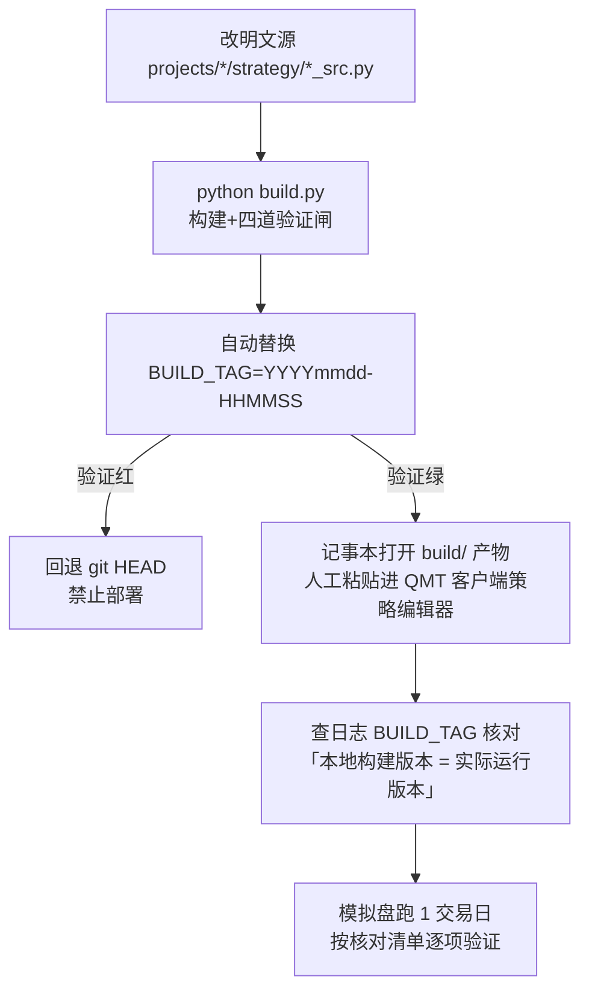
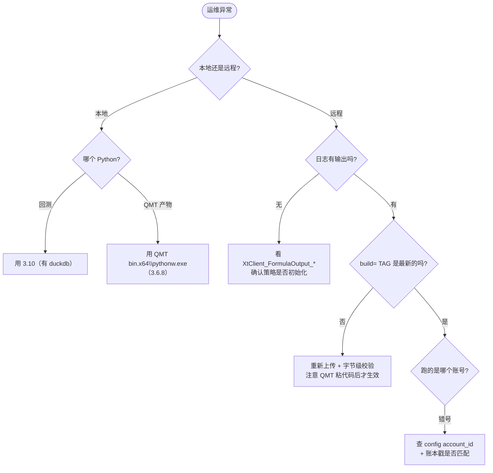

# 环境搭建与部署配置

<cite>
**本文档引用的文件**
- [全局控制台.md](file://全局控制台.md) — 工作区定位、开发环境、交易费率
- [AGENTS.md](file://AGENTS.md) — 全局红线与构建纪律
- [实盘配置指南.md](file://实盘配置指南.md)
- [快速启动.md](file://快速启动.md)
- [资金分配总表与约束.md](file://资金分配总表与约束.md)
- [config/capital_allocation.yaml](file://config/capital_allocation.yaml)
- [projects/Project_16_LightGBM股票大师/qmt_config.py](file://projects/Project_16_LightGBM股票大师/qmt_config.py) — 费率口径源
- [scripts/quark_backup.py](file://scripts/quark_backup.py) — 夸克网盘备份业务逻辑（模式选择/差分/排除规则/状态推进）
- [scripts/run_quark_backup.ps1](file://scripts/run_quark_backup.ps1) — 备份计划任务包装脚本（绝对路径/node PATH/UTF-8 BOM）
- [data/quark_backup/state.json](file://data/quark_backup/state.json) — 备份状态唯一事实源（manifest/远端 FID/归档历史）
</cite>

## 目录
1. [引言](#引言)
2. [环境矩阵](#环境矩阵)
3. [工作区布局](#工作区布局)
4. [数据源运维](#数据源运维)
5. [QMT 构建与发布流程](#qmt-构建与发布流程)
6. [实盘运行调度与监控](#实盘运行调度与监控)
7. [配置管理与资金分配](#配置管理与资金分配)
8. [交易费率口径](#交易费率口径)
9. [故障排查与运维经验](#故障排查与运维经验)
10. [章节来源](#章节来源)

## 引言

QuantLab 横跨三套 Python 环境与四块盘，部署链路从「研究代码」到「QMT 单文件产物」再到「远程模拟端」。本文档是运维侧的唯一入口。

## 环境矩阵

| 用途 | Python | 路径 / 说明 |
|---|---|---|
| **研究** | 3.11 | 因子研究、数据分析 |
| **回测工厂** | **3.10** | `C:\Users\Administrator\AppData\Local\Programs\Python\Python310`（**有 duckdb**） |
| **QMT 生产** | **3.6.8** | `D:\国金QMT交易端模拟\bin.x64\pythonw.exe`（**不是 python 目录**；⚠️ 本机无 E 盘，2026-08-29 已从 E: 修正为 D:） |
| miniqmt venv | 3.11 | `C:/Users/Administrator/.workbuddy/binaries/python/envs/miniqmt/Scripts/python.exe`（P16 定时脚本/连 miniQMT 取数专用） |
| 通用回测 | 3.13 / pandas 3.0 | 验证套件已适配（需去掉 `.date()` 比较） |

**QMT 环境自带**：numpy / pandas / xtquant。**唯一缺 pyyaml** → 任何第三方 import 必须 try/except fallback。

**新设备部署最小集**：

1. 必拷 `strategy_main.py`（GBK，**二进制拷**）+ config。
2. 完全不用拷 core/adapters 等源目录。
3. 历史 K 线需在 QMT 客户端**补全 ≥120 交易日**，否则会出现「外部池无股票通过技术信号」（不是 bug，是数据不足）。

## 工作区布局

| 区域 | 路径 | 定位 |
|---|---|---|
| **开发中枢** | `D:\QuantLab` | 因子研究 / 回测 / 风控 / QMT 构建 / 验证 |
| 生产工程 | `D:\QuantLab`（各项目 `build/`） | 实盘策略构建产物 |
| **第一数据源** | `D:/astock/` | 买断离线 parquet：daily/finance/basic + 分钟线（2009 起）+ 财务全量（PIT 字段齐），**唯一权威数据源（2026-08-29 起）**；⚠️ 本机无 E 盘 |
| 实时补充 | `qmt_self_owned`（`F:/backtest_workspace/data/duckdb/`） | 最新交易日数据，需 QMT 在线；1min 仅近 1 年 |
| 文件通信 | `D:/QMT_POOL/` | 运行时文件交换（selected / holdings / nav / sector_heat / 成本锚 cmd / peak state 等） |
| **配置统一目录** | `D:/QMT_POOL/config/` | ATR/V2/P13 三策略 config 统一读取路径（2026-08 迁移） |
| 知识库 | `F:\天翼云盘同步盘\Obsidian\量化知识库` | 长期沉淀（`knowledge_base` 为 NTFS junction） |
| 回测资产 | `F:\backtest_workspace\` | 回测数据 / 结果 / 池快照 |
| QMT 模拟端 | `D:\国金QMT交易端模拟` | 账号 `70180771`，Python 3.6.8；⚠️ 本机无 E 盘（2026-08-29 从 E: 修正） |

> ⚠️ **路径纪律**：所有治理文档以 **`D:\QuantLab`** 为准。历史文档中的 `E:\QuantLab` 已失效（E 盘不存在该目录），回测引擎 6 项修复之一就是把路径统一到 D:。

> ⚠️ **`knowledge_base` 是 NTFS junction**，target 为 `F:\天翼云盘同步盘\Obsidian\量化知识库`。**不要 git add / rm -rf / 纳入打包构建**。中文路径在 cmd/Python stdout 显示乱码是终端 codepage 不匹配，不是路径错。

## 数据源运维

### 数据源优先级

| 源 | 状态 | 说明 |
|---|---|---|
| `D:/astock/` | ✅ **第一数据源** | 5892 只，daily/finance/basic + min_{1,5,15,30,60}min parquet（2009 起），买断离线不依赖客户端 |
| `qmt_self_owned`（DuckDB） | ✅ 实时补充 | 最新交易日；1min 仅近 1 年 |
| `huicexitong` | ⛔ 已停更（2026-04-03） | 仅作交叉验证 |
| `jince_zhisuan` | 🟡 备用 | — |
| gpsj | 🟡 交叉验证用 | ⚠️ `is_st` 语义与 astock 相反，见下 |

> **配置纪律**：必须**显式声明 `data_source`**，不做 auto detector。看到 yaml 里 `source: jince_zhisuan` 要警觉（历史遗留）。

**astock 额外字段**：`is_st` / `listed_days` / `up_limit` / `down_limit`（ST 与新股过滤、精确涨跌停判断）。

### 关键数据语义

| 项 | 事实 |
|---|---|
| `adj_factor` | 是**后复权因子**（以上市首日为基准）。前复权价 = 原始价 × (adj_factor / 最新 adj_factor) |
| 回测复权口径 | **用 hfq（当日 adj_factor，PIT 安全）；qfq 才 look-ahead**（需未来数据做归一） |
| `circ_mv` | 单位是**万元**，30 亿 = 300000 |
| 日期类型 | astock parquet 日期是 `datetime.date`；pandas 3.0 下与 `datetime64` 比较需去掉 `.date()` |
| `suspend_type` | 停牌类型字段 |
| 财务 PIT | 用 **`ann_date` / `f_ann_date`** 对齐行情，**不能用 `end_date`**（否则用未来财务数据） |

> ⚠️ **gpsj `is_st` 语义反转（2026-08-27 发现，待修）**：astock `is_st`=1 是 ST、0 正常；**gpsj 的 `"ST"` 列相反：0=该股是 ST、1=正常**。`data/gpsj_reader.py::_COL_MAP` 直接透传未反转 → 凡用 gpsj_reader 的 is_st 做 ST 过滤，结果**反转**（正常股被当 ST 剔、ST 股被放行）。
> 排查：600 只面板 is_st 分布 gpsj=`1:131240 / 0:6352`，与 astock `0:131914 / 1:5678` 几乎镜像。

### 通达信筹码（历史遗留）

- `COST(N)`：累积成交量达 N% 时的价格（线性插值），1min bar 代表价 `(O+H+L+C)/4 × vol` 前复权，250 日 lookback → 与通达信 MAE 1-2%。
- **SCR 是系统技术指标不是公式函数，算法未公开**，知识库所有 SCR 公式互相不一致，只能方向近似。
- WINNER：通达信用换手率衰减的移动成本分布，简单直方图在长牛股差异巨大。
- `COST_ratio(C95/C5)` 是比值不受复权漂移影响，**可长期复用**。

## QMT 构建与发布流程



**纪律**：

1. **QMT 客户端对策略加密存储——直接复制文件到 `<QMT>\python\` 目录无效**（2026-09-10 实证），唯一生效途径是**客户端策略编辑器粘贴**；部署流程 = 构建+校验 → 记事本打开产物 → 人工粘贴 → 日志核对 BUILD_TAG。
2. QMT 是**自绘 UI**：无 UIA 控件树、无子 HWND、窗口最小化时 rect=-32000 → **粘贴不可自动化**（`deploy_paste_qmt.ps1` 失败方案留档），人工粘贴是设计内动作。
3. 粘贴后策略自动加密成密文 `STRATEGY.py`，本地改代码必须**重新粘贴**才生效。
4. 部署后必须核对日志出现新 `BUILD_TAG`（`XtClient_FormulaOutput_*.log`，GBK 读取用 `python -X utf8` 防 mojibake）。

**验证四道闸**：静态（GBK / 首行 `# coding=gbk` / `ast.parse(feature_version=(3,6))` / 无 f-string）—— 关键标记（策略名 / 账号 / BUILD_TAG / 风控阈值）—— 腐蚀（`?` 乱码计数）—— 功能（模块 exec + 单测）。

> 💀 **事故档案**：2026-08-19 审计发现 Fix4 build 编码腐蚀 4168 个 `?`（`沪深A股`→`????A??`、`买入/卖出`→`????`），**从未真正部署远程**却一直以为已上线。此外修复脚本曾因 `open("w")` + GBK 异常把 ATR build 截断为 0 字节。→ 已改为**原子写入** + pyc 校验 + 字节级校验。

## 实盘运行调度与监控

### 计划任务清单

| 任务 | 频率 | 内容 |
|---|---|---|
| `Quant_P16_CfgPremarket_0900` | 周一至周五 09:00 | **成本锚盘前生成**（2026-09-10 新增，T-20260908-002 根治）：`gen_positions_cfg_premarket.ps1` 串跑 **G2+V13+融合(ens)** 三生成器 → `D:/QMT_POOL/{g2_bridge,p16_v13_risk,p16_ensemble_bridge}/cmd/positions_cfg*.json`（融合腿 09-11 加入）；日志 `data/schedules/gen_positions_cfg_premarket.log`；**G2/V13/融合 成本锚唯一 owner**（TW 侧同名功能任务已暂停，双调度器教训 T-20260910-008）；设置 StartWhenAvailable + 电池条件放开；Interactive only（QMT 交易本身也需登录会话，风险敞口一致） |
| `Quant_P16_NightlyCheck_0100` | 每日 01:00 | **夜间体检**（2026-09-10 新增）：`nightly_check_task.ps1` → `scripts/nightly_check.py` A–G 全模块自检（数据/面板/模型/数据源/QMT/环境/报告），FAIL 时 LastTaskResult=1；`--fix` 自动修复；⚠️ 包装脚本**禁用 `$ErrorActionPreference="Stop"`**（PS5.1 下 Native stderr 重定向触发 ErrorRecord → 静默终止，09-10 实锤） |
| `QuantLab_FactorHealth_Monitor` | 每周五 19:30 | 因子 IC 健康度扫描，产物 `research_audit/factor_health_报告.md` |
| `P13_529_signal_daily` | 周一至周五 15:40 | 529 信号日更 CSV（`research/gen_529_signal_daily.py`） |
| P16 `run_scheduled.ps1` daily | 每日 16:30 / 16:45 | `xtdata_update → merge_live_features → deploy_predict → reconcile_trades → verify_model_panel_sync`；G2 retrain 成功后自动跑策略层门禁 `gate_strategy_layer.py`（FAIL 自动回滚模型指针，2026-09-10 接入） |
| P16 G2 候选夜间累积 | 每日 20:05 | `g2_candidates_night.ps1 --ab --ensemble`：纸面前向三臂信号记录（G2=N15、v3_enh/融合=N10；09-10 修复漏 `--ab --ensemble` 断流 bug） |
| `Quant_P16_V13_FinalList_2020` | 周一至周五 20:20 | **V1.3 口径对齐方案B 纸面并行（2026-09-30 新增，T-20260929-006，PAPER 阶段不接 rebalance 不下单）**：`build_v13_final.py` prob Top10 池→scorecard_real 真实评分卡→红线 58→total 降序 Top5 → `data/selections/<T>_final_list.csv` + `.meta.json`（模型/快照 sha256 + incr/daily_basic/moneyflow max_date 溯源；F2 新浪主源→moneyflow 兜底，F6 daily_basic→面板回退）；非交易日 [SKIP] exit 0、数据不新鲜 fail-loud exit 1；SPEC `specs/V13口径对齐方案B落地_SPEC_20260930.md` |
| `Quant_P16_V13_PaperParallel_2030` | 周一至周五 20:30 | **V1.3 纸面并行双臂对比（2026-09-30 新增）**：`v13_paper_parallel.py` old臂=`<T>_selection_full.csv`（09:45 重排，total≥58 top5）vs new臂=`<D>_final_list.csv`（D=max(final_list日<T)）；两臂统一执行日 T 开盘入场/第 5 交易日开盘退出、记 ret_1d、均不加 position_filter、停牌/无量 unfillable 剔除；幂等 log `results/v13_paper_parallel_log.csv` + 报告 `results/v13_paper_parallel_report.md`（含 Phase 2 门禁指标：≥15 执行交易日、new−old 日均配对差 ≥ −3bp/日、胜率差 ≤10pp）；数据停更 fail-loud exit 2 |
| P16 `paper_forward_daily` | 每日 16:45 | 前向候选收益回填（唯一合法数据源 `merged_daily_full.parquet`；到期判断用交易日历）；deploy 调用已加 `--ensemble --ens-live`（09-11 起一次产出 G2+融合 双选股） |
| P16 融合换仓（TW 任务 051bc2d9） | 周一至周五 **09:52** | 融合(ensemble) 大QMT 文件桥每日换仓（09-10 由 09:50 后移 2 分钟避 G2 同刻下单）：`rebalance_ens.py --live` → 写 `D:/QMT_POOL/p16_ensemble_bridge/cmd/orders_<date>.json`；候选滞后一天正常；跳过 G2 账本重叠票 |
| P16 融合日终对账（TW 任务 18c0c8d2） | 周一至周五 15:45 | `reconcile_ens.py` → `data/reconcile_g2_ens/`；盯 orphan/持仓差额/同票双账本（同账户双桥残余风险） |
| P16 融合桥部署 | 一次性（09-11 00:10 已上线） | `build_p16_ens.py` → `build/strategy_p16_ens_bridge.py`（BUILD 20260910-233536）→ 人工粘贴进大QMT 客户端（与 G2 桥同客户端并跑，账号 70180771 虚拟子账户）→ 日志核对 `[P16ENS][BUILD]` + `heart_<date>.json` |
| P16 retrain | 周一 17:00 | `refresh_panel_v3 → train_optuna/train_g2 --promote`；模型层门禁 G1-G4 strict + 策略层门禁（双层把关，2026-09-09/10 升级）；V1.3 `auto_promote` G0-G6 |
| `Quant_QuarkBackup_Daily` | 每日 21:20 | **开发目录 → 夸克网盘自动备份（2026-10-05 新增，T-20261005-002）**：`run_quark_backup.ps1` → `scripts/quark_backup.py`（纯标准库，**不依赖 LLM/模型在线**）；**周日自动全量快照（附 `git bundle --all` 保住未推送提交），其余日期增量**（`state.json` 按 `(size, mtime_ns)` 差分，无变更即 exit 0 跳过）；远端不可变时间戳目录 `QuantLab_backup/QuantLab_{full\|increment}_<stamp>/`，**永不覆盖**；详见下方「夸克网盘自动备份」 |
| `Quant_AstockKit_Update` | 周一至周五 17:30 | astock_kit 在线补充数据（两融/股东户数/大宗/解禁/龙虎榜/涨停池/行业资金流/研报）落地 `data/astock_kit_data/<YYYYMMDD>/`；⚠️ 曾出现 0x800710E0 条件拒绝，检查任务的电源/唤醒条件设置 |

> ⚠️ **双调度器红线（T-20260910-008 教训）**：QuantLab（schtasks）与 TW（TraeWORK 定时任务）**都可能对同一产物文件建调度**——新建任何定时任务前，必须互查对方已注册的任务清单，否则同日双注册撞车且首跑归因极难。

> ⚠️ **调度器已是三层（2026-09-23 起）**：① Windows `Quant*`（40 项，全 S4U，开机即跑、不依赖登录；2026-09-30 增 V13 FinalList/PaperParallel 两条）；② TRAE Agent 面板；③ **WorkBuddy 自动化面板**（P16 相关 8 条，2026-09-23 建）。新建任何定时任务前必须**三查**，三层中任意两层存在同一目的任务即为调度冲突。**可靠性排序：Windows 计划任务 > TRAE/WB 自动化**——WorkBuddy 官方文档明确「客户端退出或电脑休眠则不触发」，故**硬时点、不可补救的动作（真实下单）不应迁入 WorkBuddy**。

### 夸克网盘自动备份（`Quant_QuarkBackup_Daily`，2026-10-05 建，T-20261005-002）

**性质**：`D:\QuantLab` 开发目录 → 夸克网盘的**异地灾备**。核心动作全部下沉为纯 Python 脚本（标准库，**不依赖 LLM/Agent/模型在线**），符合「模型卡住不阻塞业务动作」的定时任务降级原则。

| 项 | 值 |
|---|---|
| 计划任务 | `Quant_QuarkBackup_Daily`（每日 21:20，`S4U` / `RunLevel=Highest`） |
| 包装脚本 | `scripts/run_quark_backup.ps1`（**必须带 UTF-8 BOM**） |
| 业务脚本 | `scripts/quark_backup.py`（纯标准库） |
| 远端目录 | `夸克网盘/来自：OpenClaw/QuantLab_backup/QuantLab_{full\|increment}_<YYYYmmdd-HHMMSS>/` |
| 远端根 FID | `28184179e44648c2a325f628ad423c5d`（**首次由 CLI 返回的真实值，禁止假定为 `0`**） |
| 状态/日志 | `data/quark_backup/{state.json, backup.log, scheduler.log}` |
| 退出码 | `0` 成功/无变更 · `1` 上传失败 · `2` 前置不满足 · `3` 备份自身异常 |

**已实测证据**（`data/quark_backup/backup.log`）：首次全量 5118 文件 / 1027.0MB → ZIP 652.9MB（`sha256=5347b682…`）→ 上传 `code=0` / 121s；随后一次真实增量（2 文件，`sha256=3ee5dbbe…`）上传 `code=0` / 6s，远端 `…/QuantLab_backup/20261005-162153`；再跑一次变更=0 → exit 0 不建空档（幂等）。日志同时确认凭据白名单每次生效（3 个文件被排除）。

**模式**：首次运行强制全量；此后 `auto` 模式**周日全量、其余日增量**。全量归档额外打 `git bundle --all`（含未推送提交，以 `ZIP_STORED` 存放，因 pack 已压缩），Git bundle 失败即作废全量；增量归档不带历史，由每周全量兜底。

**状态一致性三原则**（改动脚本时勿破坏）：

1. ZIP **完全关闭后**才计算 SHA-256（否则摘要与最终归档不一致）。
2. 任一文件 `zf.write()` 失败 → 归档作废、删除、**不推进 manifest**，下次重跑仍覆盖本次变更。
3. **上传成功后才**更新 manifest；失败时本地归档保留待重传。

**排除规则**：`.git`（改由 bundle 保存）、`data/quark_backup`（防递归打包自身）、各 `__pycache__`/缓存目录、`node_modules`、Agent 运行时目录、`.log/.tmp/.lock/.pack/.idx`、时间戳 `.bak_*`、**单文件 > 64 MB**。凭据硬排除 `.mcp.json`、`config/.web_search_keys.yaml`、`config/data_source_keys.json` 及 `.env`/key/token/cookie/credential 命名模式——**新增凭据文件时必须同步加进 `EXCLUDE_*`**。

**已知边界（不掩盖）**：

- 差分依据是 `(size, mtime_ns)`，非内容哈希；内容变而大小与纳秒 mtime 均保持不变时可能漏检。
- **不传播删除、不清理远端旧快照**（CLI 无删除能力），远端快照会持续累积，需人工清理。
- > 64 MB 的大模型/数据资产**不进备份**。
- `data/quark_backup` 整体被排除，故 `state.json` 本身不上传；本地状态丢失会退化为重新全量。
- 每日运行，不排除周末与法定节假日。

> ⚠️ **与既有夸克 TRAE 任务 `5f2bd77c` 无冲突（三查已做）**：`5f2bd77c`「夸克行情数据分享每周更新检查」是**周一 03:00 的行情离线包转存**（目标目录 `行情数据`，消费方 `scripts/update_astock_from_e.py`），本任务是**代码目录灾备**（目标 `QuantLab_backup`）。二者调度层、频率、输入、输出、远端目录全不同，**不构成双调度器冲突**，排查时勿误判为重复注册。

### WorkBuddy 自动化层（P16，2026-09-23 建，T-20260923-001）

| 自动化 | 触发 | 状态 | 说明 |
|---|---|---|---|
| P16 候选预生成 | 09:15 | ACTIVE | `deploy_predict.py --model v3 --top-k 10` 预生成当日主候选；**不推送** |
| P16 集合竞价增强预判 | 09:25 | ACTIVE | G2 候选检查 + 分组取数 + F3 缓存 + 交叉验证 + 富途推送（取数降级链改造幅度最大） |
| 模拟账号盘后监控 | 15:05 | ACTIVE | 8 只持仓收盘行情 → HTML 简报（只读，输出 `D:\Workspace`） |
| P16 G2 日终对账 | 15:45 | ACTIVE | `reconcile_g2.py` + 盘后总览卡 |
| P16 融合日终对账 | 15:50 | ACTIVE | `reconcile_ens.py` + 盘后总览卡 |
| P16 开盘实时复核 | **09:38** | **PAUSED** | **真实下单**；较 TRAE 侧提前 7 分钟，为 10:05 guard 留落盘余量 |
| P16 G2 换仓 | **09:45** | **PAUSED** | **真实下单**；guard 10:07 |
| P16 融合换仓 | **09:47** | **PAUSED** | **真实下单**；guard 10:08 |

**点亮三条下单任务的前置条件（硬性）**：必须先**手动暂停 TRAE Agent 面板**对应三条（该面板在本环境不可自动化），否则当日**双下单**。

**WorkBuddy 环境约定（迁移后固化）**：

1. **禁用裸 `python`**——WorkBuddy shell 的 PATH 不可靠（`ls`/`dirname` 均 not found）。必须写绝对路径 `C:\Users\Administrator\.workbuddy\binaries\python\envs\miniqmt\Scripts\python.exe`（3.11，含 numpy/pandas/lightgbm/pyarrow/**xtquant**）。⚠️ TRAE 内置解释器（3.10.11）**缺 xtquant**，不可用于换仓类任务。
2. **数据源映射**：`mcp_tdx` / `full-link` / `mcp_plugin_TDX_tdx` → **tdx-connector**（唯一 TDX 通道）；`sina-finance` → mx-ds-mcp / westock-mcp；`iFind` → wind-finance。**`scripts/wudao_client.py` 是本地 HTTP 直连脚本，不依赖 TRAE 插件，可继续使用**。
3. **飞书推送一律走项目 `push_*.py`**（路径由代码固化，不随文档漂移）。

**guard 时点契约（迁移时的最高风险）**：guard 的幂等判据是**产物文件**，**不认「正在执行」**。主任务若在 guard 时点尚未落盘，guard 判定「未执行」并补跑 `--live` → **重复下单**。故改动「主任务触发时间或执行耗时」前必须先核算落盘余量（当前余量 ≥15 分钟）。

### 飞书推送通道（P16）

| 项 | 值 |
|---|---|
| bot 应用 | `cli_aade2524ddbd9bd6`（品牌 feishu），`LARK_PUSH_AS="bot"` |
| 接收目标 | **仅私聊** `ou_bd13444d8ea53c28249c669f43f3eeff`；`LARK_PUSH_CHAT_ID=""`（群发已关闭） |
| 凭据位置 | `~/.lark-cli/config.json`，appSecret 存**系统 keychain**（与 TRAE 无关，WorkBuddy 侧同样可用） |
| lark-cli 主路径 | **`C:\Users\Administrator\bin\lark-cli.exe`**（2026-09-23 路径加固，T-20260923-002） |
| lark-cli 回退路径 | `...\.trae-cn\plugins\trae-remote-official\lark\1.0.5\bin\lark-cli.exe`（保留未删） |
| 来源标记 | 环境变量 **`LARK_SRC_TAG`**——设置后卡片标题/文本自动加前缀，用于区分同 bot 同私聊的重复推送 |

**路径加固写法**（三处一致：`qmt_config.py` / `g2_config.py` / `g2_ens_config.py`）：主路径存在则用主路径，否则自动回退 TRAE 目录 —— 避免 TRAE 升级/卸载中断全部推送。

**来源标记实现**（T-20260923-003）：`qmt_card.py::src_tag()` / `apply_src_tag()` 在推送单点出口 `send_lark_card()` 对 `header.title` 打前缀（幂等、空标题/非 dict 安全）；`qmt_monitor.py` 与 `qmt_bridge_client.py` / `qmt_bridge_client_ens.py` 的文本通道同步。**未设 `LARK_SRC_TAG` 时返回空串 → 行为与改造前逐字节一致**（TRAE/Windows 侧零影响）。WorkBuddy 侧推送统一带 `[WB]` 前缀，**收件侧看到无前缀即 TRAE/Windows 侧**。

> ⚠️ 文档漂移坑：多处 message/文档写 `lark\1.0.4\...`，该版本**不存在**（实际只有 1.0.5）。排查推送静默失败先查版本号与上表两条路径。

> 🔧 **统一自检出口（2026-10-02 确立，取代逐处硬编码）**：任何脚本/任务 prompt 需要发飞书时，**统一走 `projects/Project_16_LightGBM股票大师/lark_push.py`，不直接调 lark-cli、不硬编码插件版本目录**——
>
> ```bash
> python lark_push.py --check                                              # 探测真实 cli 路径并打印「存在=True」
> python lark_push.py --file <txt路径> --user-id <open_id> --as bot        # 正文先写 UTF-8 临时文本再推
> ```
>
> 该脚本按「主路径 → probe 探测」自动定位，`--check` 输出会标明 `来源=probe`。**理由**：插件版本目录会随 TRAE 插件升级而腐化（1.0.4 已消失、现为 1.0.5），任何写死 `...\lark\1.0.x\bin\lark-cli.exe` 的 prompt 都会在某次升级后静默失效。2026-10-02 现场核实：TRAE 09:45 任务 prompt 的 step 5 曾残留 1.0.4 硬编码路径（**已于 2026-10-02 第 8 次 `Schedule update` 改走本统一出口并生效，独立 `Schedule get` 回读验收通过，看板 `T-20261002-002` 已关闭**），**后果仅限飞书推送失败，不影响下单**；现该 prompt 已不再出现任何插件版本目录硬编码。

> ⚠️ **S4U 会话推送坑（T-20260923-004，P0，已修复）**：`OPENCLAW_CLI` 环境变量在**交互会话为空、在 S4U 会话为 `1`**。lark-cli 见到它即判定「处于 openclaw 上下文」，要求 `lark-cli config bind`，**拒绝回退本地 `config.json`**，报 `config/not_configured`（原文 `openclaw context detected but lark-cli is not bound to it`）。后果：**2026-09-14 起全部 Windows 计划任务（S4U）的飞书推送静默失败约 8 个交易日**——推送失败只写日志、不改 exit code，故无告警。
>
> **修法（现行约定）**：4 处推送出口（`qmt_card._env_for_cli` / `qmt_bridge_client.notify_feishu` / `qmt_bridge_client_ens.notify_feishu` / `lunch_report_20260911.send_lark_message`）**按前缀整体清扫** `OPENCLAW*`、`HERMES*`、`LARK_CHANNEL`，**不得再逐条枚举**（原清单 pop 了 `HERMES_HOME`/`OPENCLAW_HOME`/`LARK_CHANNEL`，唯独漏 `OPENCLAW_CLI`，且 `OPENCLAW_HOME` 本机根本不存在）。
>
> **排障口诀**：推送失败先看错误 JSON 的 `message` 字段，不要只看 `subtype`——`not_configured` 有「凭据缺失」与「上下文未绑定」两种截然不同的成因，本坑属后者，改凭据方向查是错的。
>
> **验证方式**：交互会话推送成功**不能**代表 S4U 也会成功（本坑正是这种情形）。必须建临时 S4U 计划任务（`New-ScheduledTaskPrincipal -LogonType S4U`）跑实际代码路径，收工即 `Unregister`。

> ⚠️ **P16 调度环境坑（2026-08-28 修复）**：`run_scheduled.ps1` 需在 `$ErrorActionPreference` 后注入 `$env:PYTHONIOENCODING = "utf-8"`，一次覆盖全部 Python 子脚本。否则打印 ✅ 等字符时 stdout GBK `UnicodeEncodeError` → exit=1，reconcile 的「持仓不一致需人工核查」实为**编码崩溃假警报**。

**运维检查项**：

- 每次改调度后确认 `LastTaskResult=0`（`0x800710E0` 为调度环境一次性失败，可重试）。
- 新增路径后确认**旧任务没有仍指向旧路径**（曾出现 16:30 数据更新跑旧路径、新路径增量停在 8/25，导致前向验证样本停更 2 天）。

### 本机开发工具链：OpenCode Zen 免费模型网关（2026-10-12 建）

**定位**：本机开发工具（**不属于 QuantLab 框架，代码在仓库外**），让 WorkBuddy / Trae / Cline / Continue 等任意 OpenAI 兼容客户端用上 `opencode.ai/zen` 的免费模型。

| 项 | 值 |
|---|---|
| 部署目录 | **`D:\zen-gateway\`**（⚠️ `D:\QuantLab\workspace\_superseded_20261012\` 是废弃旧副本，勿用） |
| 网关进程 | `zen-gateway.mjs`，监听 `127.0.0.1:8890`（**只监听本机，刻意不做 LAN 开放**） |
| 客户端填法 | Base URL `http://127.0.0.1:8890/v1`，API Key `public`，模型 ID 见该目录说明书第五节 |
| 探活 | `GET /healthz`（不走上游）；`GET /v1/free-models`（上游免费清单） |
| 开机自启 | `%APPDATA%\...\Startup\ZenGateway.vbs`（卸载：删该文件或 `安装自启.bat uninstall`） |
| 运维脚本 | `启动网关.bat`（可见）/ `启动网关-静默.vbs`（后台）/ `停止网关.bat` / `检查网关.bat` |
| WorkBuddy 配置 | `%USERPROFILE%\.workbuddy-ai\models.json`，Zen 10 条（启用 7 / 停用 3）；**改完需重启 WorkBuddy 生效** |
| 文档 | `D:\zen-gateway\OpenCode-Free模型接入说明书.md` |

**踩坑记录（勿重复踩）**：

1. **上游只认流式**——非流式请求一律被上游 403 `FreeTierError`，**与对话轮次/工具数无关**（原说明书「轮次太少」说法已证伪）。**网关已做适配**：客户端发非流式时，网关自动转成流式发上游、再把 SSE 聚合成普通 JSON 返回（`ZEN_GW_FORCE_STREAM`，默认开）→ 非流式客户端（含 Trae「添加模型」的连通性探测）也能用。tool_calls 聚合已实测通过。
2. **10 个免费模型实测只有 6 个能出字**：可用 = `step-5-preview-free` / `big-pickle` / `mimo-v2.6-flash-free` / `space-bunny-free` + 2 个推理型（`longcat-2.5-preview-free` / `nemotron-3.5-lightning-free`）；`ling-3.1-flash-free` 上游 429 临时故障；`jev-1.13-free` 协议不支持；`muse-spark-1.2/1.3` **地区限制（大陆永久不可用）**。
3. **免费模型判据**：不能用「带 `-free` 后缀」（`big-pickle` 无后缀但免费；无后缀的其余 73 个全是付费）。用 `/v1/free-models`。
4. **Trae CN 接法**（`设置 > 模型 > 添加模型 > 自定义模型`）：API 格式选 **OpenAI Chat Completions 格式**；**关闭「完整 URL」开关**后填 `http://127.0.0.1:8890/v1`；模型 ID 原样抄；API 密钥 `public`；高级配置「模型系列」选**默认**、图片输入关、上下文输入 128000/输出 32768。每个模型单独添加一次。
5. ⚠️ **token 开销**：网关每请求并入 22 个 opencode 特征工具定义，**约 1.3 万 tokens**（大部分命中上游 prompt cache，`cached_tokens` 可观测）；128k 窗口下约占 10%。
6. **沙箱限制**：`wscript` / `wmic` / `schtasks` 被安全策略拉黑，`Start-Process` 子进程会被回收 → **Agent 无法留常驻进程**，常驻靠双击 vbs 或开机自启。
7. ⚠️ **安全红线**：网关把整个请求体（system prompt + 工具 + 完整对话历史）转发到 `opencode.ai` → **禁止用于实盘/账户/策略源码会话**；且该方案靠伪造 UA 绕过上游免费层门禁，违反上游 ToS、极脆弱。

### 日志位置

| 类型 | 路径 | 编码 |
|---|---|---|
| 业务日志（策略 print） | `XtClient_FormulaOutput_YYYYMMDD.log` | **UTF-8** |
| 引擎层 INFO | `XtClient_Formula_*.log`（不含业务 print） | — |
| 远程实盘 | `\\192.168.31.131\国金qmt交易端模拟\userdata\log` | — |

> CMOS 日期错乱时 `strategy_log_*.txt` 文件名不可信（可能显示 202311xx），看内容里 `today=`（行情时间）才是真实日期。

## 配置管理与资金分配

### 三级配置级联

```
config/settings.yaml（全局：数据源/回测窗/佣金滑点/因子预处理/默认股票池）
        ↓
config/trading_config.yaml（实盘：账号/初始资金/风控阈值/调度/通知）
        ↓
projects/*/config/*.yaml（项目级：调仓频率/top_n/因子权重）
```

### 资金分配（硬规则）

**单一事实源**：`config/capital_allocation.yaml`（实际在 `D:/QMT_POOL/config/`）。校验器 `scripts/check_capital_allocation.py`。

| 策略 key | 锁定本金 | 最大持仓 | 账号 |
|---|---:|---:|---|
| `atr_lowvol_equalweight` | 100,000 | 8 | `70180771` |
| `value_smallcap_v2` | 100,000 | 80 | `70180771` |
| `huang529_breakout` | 100,000 | 12 | `70180771` |
| Project_16（策略真实口径） | 100,472 | 2 | `67014907` |
| **合计（70180771）** | **300,000** | — | ≤ 账户总资产 10,000,000 |

**三条硬规则**：

1. 每个策略锁定独立 `capital_base`，绝不抢占他人资金/持仓。
2. **`Σ capital_base ≤ 账户实际总资产`**。
3. 改了必须跑校验器，退出码 0 才许部署。

> **账户总额**需在国金 QMT 客户端「查询 → 资金股份 → 总资产」查后填入 `capital_allocation.yaml`（2026-08-05 填报 1000 万）。

### 双账号（2026-08-25 确认）

| 账号 | 用途 | 通道 |
|---|---|---|
| `67014907` | Project_16 LightGBM（**仍在用**） | miniQMT / xtquant |
| `70180771` | ATR低波 / 价值小盘V2 / 黄氏529 | 纯 QMT 端 |

> ⚠️ 「67014907 已停用」的说法**已被推翻**。引用错号会废单。

### 持票账本 account_id 戳

三大 QMT 策略 + P16 均已实现：加载时校验 `account_id` 戳，缺戳或不匹配 → **自动备份旧档**（`.bak_acct_<旧戳>_<时间戳>`）+ **空仓起步**（fail-safe）。

> 起因（T-20260824-001）：远程 config 的 `account_id` 未随迁号同步 → 八笔买入零成交、账本 8 只幻影持仓、季度键被锁死整季不再建仓。

## 交易费率口径

> **全项目统一口径**（回测 / 纸面 / 持仓盈亏同费率），来源 `projects/Project_16_LightGBM股票大师/qmt_config.py` 第 33-38 行，2026-08-27 登记。

| 项目 | 费率 | 说明 |
|---|---|---|
| 佣金 | 万 2（0.02%）**双边** | 单笔最低 5 元 |
| 印花税 | 万 5（0.05%）**仅卖出** | — |
| 过户费 | 万 0.1（0.001%）**仅沪市** | 60 开头双边收，深市（00/30）不收 |

**示例**（单笔约 5 万）：买入沪市 ≈ 10.5 元（佣金 10 + 过户费 0.5）；卖出沪市 ≈ 35.5 元（佣金 10 + 印花税 25 + 过户费 0.5）。

## 故障排查与运维经验

### 决策树



### 高频运维坑

| 现象 | 根因 / 处置 |
|---|---|
| 数据停在 N 天前 | 增量管道跑到了旧路径（新路径 `data_live/incremental_daily.parquet`），检查计划任务指向 |
| 定时任务 exit=1 但无业务错误 | `PYTHONIOENCODING` 缺失导致 GBK 编码崩溃 |
| 选股结果多日不变 | 面板/快照停更；检查 `verify_model_panel_sync.py` 与 deploy 是否读增量快照 |
| 部署后行为没变 | QMT 端代码已加密，需**重新粘贴**；或 build 未通过字节级校验 |
| 中文变 `?` | 编码腐蚀，回退 git HEAD，禁止部署 |
| 账户总额校验失败 | 重新查 QMT 客户端总资产并更新 `capital_allocation.yaml` |
| 清仓脚本报缺 xtquant | 必须用 QMT 自带解释器：`& 'E:\国金QMT交易端模拟\bin.x64\pythonw.exe' <script> --execute` |
| 飞书推送静默失败 / 全无推送 | ①**先看错误 JSON 的 `message` 字段**——若含 `openclaw context detected` 即 T-20260923-004 上下文坑（`OPENCLAW_CLI` 未清扫，S4U 会话必现），与凭据无关；②查 `LARK_CLI` 两条路径是否都存在（2026-09-23 已加固为「主路径 + 自动回退」）；③查 lark 版本号（文档写 `1.0.4` 已失效，实际只有 `1.0.5`）；④确认 `~/.lark-cli/config.json` 与系统 keychain 凭据在位；⑤失败会落盘 `data/schedules/feishu_fallback_<date>.json` |
| Windows 计划任务侧推送全失败、TRAE 侧正常 | S4U 会话环境差异坑（T-20260923-004）：`OPENCLAW_CLI=1` 只在 S4U 存在 → lark-cli 拒绝本地配置。四出口已改为按前缀清扫 `OPENCLAW*`/`HERMES*`。**交互会话推送成功不能代表 S4U 也成功**，验证须建临时 S4U 任务跑真实代码路径 |
| 分不清飞书消息来自哪个调度器 | WorkBuddy 侧推送标题带 **`[WB]`** 前缀（`LARK_SRC_TAG` 机制）；**无前缀 = TRAE/Windows 侧** |
| WorkBuddy 自动化里脚本找不到 `python` | WorkBuddy shell 的 PATH 不可靠，必须写绝对路径 `...\envs\miniqmt\Scripts\python.exe`；不要用 TRAE 内置解释器（缺 xtquant） |
| 同一目的任务在两个调度器重复跑 | 调度器已三层（Windows `Quant*` / TRAE 面板 / WorkBuddy 自动化），新建前必须**三查**；下单类任务尤其危险（guard 只认产物文件、不认「正在执行」→ 会补跑造成重复下单） |
| S4U 计划任务里脚本找不到 `python` / `node` | S4U session 0 的 PATH 不含二者（`python` 只有 WindowsApps 空壳会 `exit 9009`）。包装脚本必须写**绝对解释器路径** `C:\Users\Administrator\.workbuddy\binaries\python\envs\miniqmt\Scripts\python.exe`，并显式前置 `C:\Program Files\nodejs` 到 `$env:Path` |
| 含中文的 `.ps1` 在计划任务里解析崩溃 | PS 5.1 对无 BOM 文件按 ANSI/GBK 解码 → 中文乱码吞引号 → 级联「意外的标记」。**每次编辑后必须校验 BOM 仍在**，并设 `PYTHONIOENCODING=utf-8` + `[Console]::OutputEncoding` 对齐编码 |
| 备份「看起来成功」但 manifest 已推进 | 三条状态一致性铁律：ZIP 关闭后才算 SHA-256、任一写入失败即作废归档、上传成功后才推进 manifest。破坏任一条都会永久漏备份且无声 |

### 备份与回滚纪律

| 资产 | 备份约定 |
|---|---|
| 策略 build | git HEAD 为准 + `.bak_<时间戳>` |
| 持票账本 | 自动 `.bak_acct_<旧戳>_<时间戳>` |
| 模型（P16） | `versions/models/lgb_model_v3_pre_promote_<时间戳>.txt`，正式模型设只读 |
| 面板（P16） | `versions/panels_bak_<日期>/` |
| 共享数据层改动 | 改动前先备份 + 清存量用法（曾发生 `data/astock_reader.py` 被未登记 diff 静默改造，影响全仓 20+ 脚本口径） |
| **整个开发目录** | 夸克网盘异地灾备 `Quant_QuarkBackup_Daily`（每日 21:20，周日全量 / 平日增量，全量含 `git bundle --all`）；⚠️ 不覆盖远端旧快照、不清理，需人工定期清理；> 64 MB 单文件不入备份 |

## 章节来源

- [全局控制台.md:17-40](file://全局控制台.md#L17-L40)
- [全局控制台.md:360-400](file://全局控制台.md#L360-L400)
- [AGENTS.md:92-160](file://AGENTS.md#L92-L160)
- [实盘配置指南.md](file://实盘配置指南.md)
- [资金分配总表与约束.md](file://资金分配总表与约束.md)
