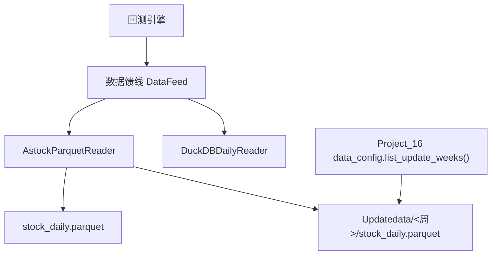
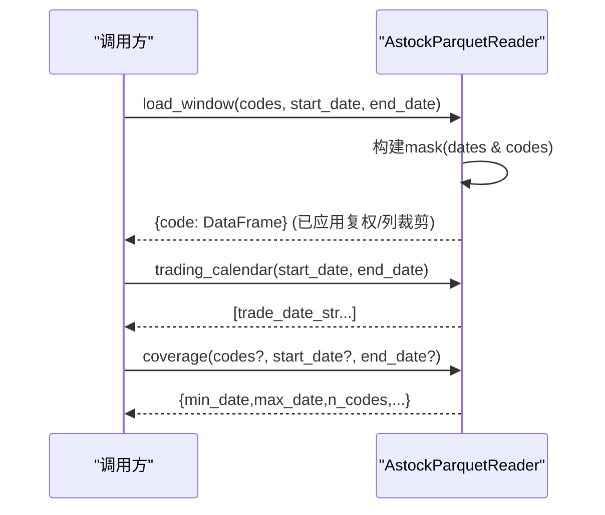
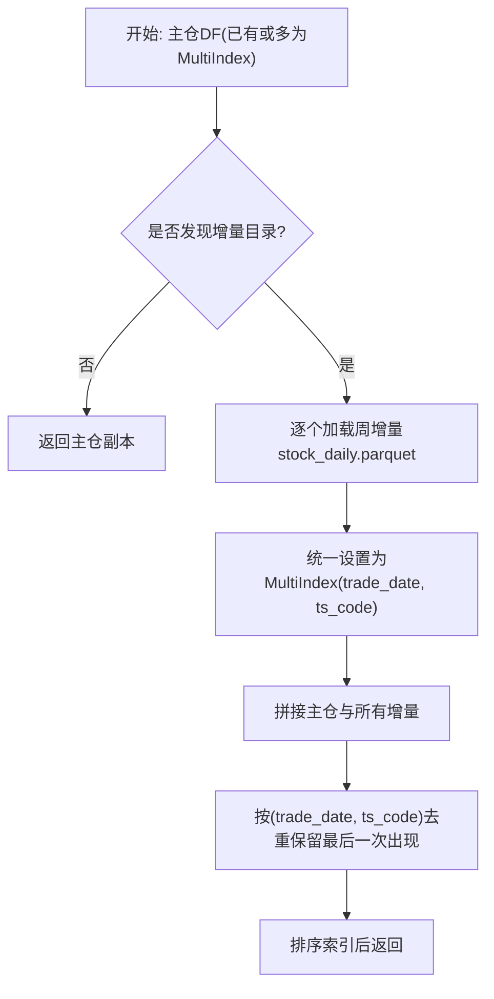

# Astock Parquet数据源实现

<cite>
**本文引用的文件**
- [data/astock_reader.py](file://data/astock_reader.py)
- [projects/Project_16_LightGBM股票大师/data_config.py](file://projects/Project_16_LightGBM股票大师/data_config.py)
- [data/feed.py](file://data/feed.py)
- [backtest/engine.py](file://backtest/engine.py)
- [backtest/report.py](file://backtest/report.py)
- [data/duckdb_reader.py](file://data/duckdb_reader.py)
- [scripts/update_astock_from_e.py](file://scripts/update_astock_from_e.py)
- [scripts/refresh_online_incremental.py](file://scripts/refresh_online_incremental.py)
- [scripts/migrate_astock_full_v2.py](file://scripts/migrate_astock_full_v2.py)
</cite>

## 目录
1. [引言](#引言)
2. [项目结构与角色](#项目结构与角色)
3. [核心组件总览](#核心组件总览)
4. [架构与数据流](#架构与数据流)
5. [关键机制深度解析](#关键机制深度解析)
   - [严格整体迁移（FULL/INCR 指纹确认制）](#严格整体迁移2026-10-03-立scriptsmigrate_astock_full_v2py14-张-full--1-个-incr)
   - [增量合并与主仓+Updatedata优先策略](#增量合并与主仓updatedata优先策略)
   - [复权因子处理与价格转换](#复权因子处理与价格转换)
   - [列选择优化与内存占用控制](#列选择优化与内存占用控制)
   - [MultiIndex设计与索引规范](#multindex设计与索引规范)
   - [load_window筛选与输出对齐](#load_window筛选与输出对齐)
   - [交易日历生成](#交易日历生成)
   - [覆盖度检测与信息统计](#覆盖度检测与信息统计)
   - [去重策略与容错设计](#去重策略与容错设计)
   - [WAL检测与并发同步告警](#wal检测与并发同步告警)
6. [配置与调优](#配置与调优)
7. [性能评估与建议](#性能评估与建议)
8. [故障诊断手册](#故障诊断手册)
9. [扩展指导](#扩展指导)
10. [结论](#结论)

## 引言
本文面向A股日线Parquet数据源 AstockParquetReader 的实现，系统阐述其在回测中的数据接入、增量合并、复权换算、列裁剪、索引结构、日历与覆盖度统计、容错与并发同步告警等核心机制。该读者采用鸭子类型接口（load_window/trading_calendar/coverage/close），可与DuckDB读器互换，上层引擎无需改动。

## 项目结构与角色
- data/astock_reader.py：实现AstockParquetReader，读取E:/astock/daily/stock_daily.parquet，并按需要合并Updatedata增量子目录的周增量，提供统一的回测接口。
- projects/Project_16_LightGBM股票大师/data_config.py：集中管理ASTOCK_DIR、UPDATE_DATA_DIR等路径，并实现list_update_weeks扫描逻辑供增量合并调用。
- data/feed.py：高层数据访问入口DataFeed，按source分发到astock parquet或duckdb后端。
- backtest/engine.py 与 backtest/report.py：回测引擎聚合reader的coverage和wal_detected等状态字段，写入summary与日志。
- data/duckdb_reader.py：提供WAL检测机制范式（针对DuckDB），为parquet读器参考其并发同步风险报告方式。



图表来源
- [data/astock_reader.py:27-65](file://data/astock_reader.py#L27-L65)
- [projects/Project_16_LightGBM股票大师/data_config.py:43-101](file://projects/Project_16_LightGBM股票大师/data_config.py#L43-L101)
- [data/feed.py:17-41](file://data/feed.py#L17-L41)

章节来源
- [data/astock_reader.py:1-115](file://data/astock_reader.py#L1-L115)
- [projects/Project_16_LightGBM股票大师/data_config.py:11-101](file://projects/Project_16_LightGBM股票大师/data_config.py#L11-L101)
- [data/feed.py:17-41](file://data/feed.py#L17-L41)

## 核心组件总览
- AstockParquetReader：构造时完成文件存在性校验、列裁剪、构建MultiIndex、增量合并；运行时提供日期窗口筛选、交易日列表与覆盖度统计。
- 增量模块_merge_update_daily：动态导入data_config.list_update_weeks，逐个加载周增量parquet，转为MultiIndex后与主仓concat并按(trade_date, ts_code)去重保留最新行（增量优先）。
- 复权换算：在load_window内，raw模式下使用原始价；hfq模式下乘以adj_factor；qfq模式下以最新adj_factor为基准进行前复权归一化。
- 列选择：构造阶段通过pyarrow扫描schema，仅读取所需列（默认14个关键字段+adj_factor等可选列），显著降低大表内存占用。

章节来源
- [data/astock_reader.py:78-162](file://data/astock_reader.py#L78-L162)
- [data/astock_reader.py:27-65](file://data/astock_reader.py#L27-L65)

## 架构与数据流
- 初始化流程：构造函数检查数据源文件、按需裁剪列、设置MultiIndex、触发增量合并、缓存dates/codes用于快速过滤。
- 请求流程：load_window根据codes与[start_date,end_date]构建掩码，分组返回每只股票的DataFrame；trading_calendar基于索引提取唯一交易日；coverage生成描述数据范围、行数、数据源时间戳等元信息。



图表来源
- [data/astock_reader.py:116-204](file://data/astock_reader.py#L116-L204)

章节来源
- [data/astock_reader.py:78-204](file://data/astock_reader.py#L78-L204)

## 关键机制深度解析

### 离线数据升级制度（2026-09-14 立，E 盘离线包 → D:/astock）

主库升级流程见 `scripts/update_astock_from_e.py`（合并式升级语义），制度要点：

> ⚠️ **与严格整体迁移的区别**：本节是「合并式」——只增不删、冲突以 E 版为主、主键去重。用户 2026-10-03 拍板的「全量就整体替换、增量就单独归档」是**另一套严格语义**，见下节 `scripts/migrate_astock_full_v2.py`，**两者不可互相替代**。日常周更用本节脚本；采购全量数据包做整体换代才用 v2 脚本，且 v2 必须带 `--accept-plan` 指纹确认。

- **主行情（daily/stock_daily）**：E 盘离线包若有到最新日期的**全量版** → **不备份、直接全量替换迁移**（`replace=True`，写临时文件 `.tmp_full` 后 `os.replace` 原子替换 = 删除旧文件 + 迁移新全量版）；若只有**增量版** → **增量文件放增量目录、不合并进主库**（防增量合并口径污染）。
- **其他数据（finance/lhb/research/board/board_fundflow/basic）**：可合并（按主键去重、冲突以 E 版为准、只增不删），写前备份为 `<name>.bak_<run-tag>`。
- **2026-10-22 修订：finance 8 表改为「备份 + E 版整体替换」**（`put=True`）。原因：同一 `(ts_code, end_date, ann_date)` 下存在多条**内容不同**的版本记录（修订稿/更正公告），按主键合并会把 `fina_indicator` 676,049 行坍缩到 377,047 行、`balancesheet` 445,775→342,121，等于丢掉一半历史且 PIT 语义错乱。现改为整表替换（先备份、写 `.tmp_put` 后 `os.replace`），并丢弃 E 端残留 `__index_level_0__` 列、按 D 列序对齐；门禁为 E 行数 ≥ D 行数 50%。其余 5 类表仍走主键合并。
- **2026-10-22 新增 `--e-layout flat-sub`**：网盘文件按「五类子目录\文件名」镜像落盘（子目录根下直接放表、不带「更新至YYYY.M.D」版本文件夹）时使用；`nested` 布局的版本目录由 `--e-version`（如 `2026.10.16`）指定，缺省自动选五类目录齐备的最大版本，不再写死单一日期的目录名。
- **安全**：任何一步异常立即停止，后续表不动；写后必须复核（行数/日期范围）并生成验证报告；执行前 `--dry-run`（默认）只打印计划不写盘。
- **校验**：全量替换前校验 E 行数 ≥ D 行数（否则拒绝，判定 E 非全量版）；合并模式先检查 index 层级一致（replace 模式跳过该检查）。

### 严格整体迁移（2026-10-03 立，`scripts/migrate_astock_full_v2.py`；14 张 FULL + 1 个 INCR）

> 与上面 `update_astock_from_e.py` 的区别：前者是「合并式升级」（只增不删、主键去重）；本脚本按用户指令实现**严格语义**——E 侧是全量就整体替换 D 侧主库（旧版即删除），E 侧只是增量就单独归档、不混进主库。两者不可混用同一个脚本。

**FULL / INCR 路由语义**（用户 2026-10-03 拍板）：

| 类别 | 判定 | 动作 |
| --- | --- | --- |
| FULL | E 侧文件是全量版 | 整体替换 D 侧对应主库文件，**删除旧版本** |
| INCR | E 侧文件只是增量 | **不混入 FULL 主库**，单独归档到 `D:\astock\_incremental\<group>\` |

14 张 FULL = 8 张财务（finance/）+ `daily/stock_daily`、`board/ths_daily`、`lhb/top_list`、`research/report_rc_daily`、`board_fundflow/moneyflow_ind_ths`、`basic/stock_basic`。
唯一 INCR = `E:\temp\行情数据\stock_daily.parquet` → `D:\astock\_incremental\daily\stock_daily_incr_<日期>.parquet`。

**计划指纹纪律（核心风控，两步不可省）**：把「不可逆后果」哈希成 16 位短指纹，`--apply` 必须带 `--accept-plan <指纹>` 精确承认；计划一变指纹即变，旧令牌自动失效。指纹必须绑定四样东西，缺一即形同虚设：

1. **不可逆后果**：D 独有行数、日线缺口行数、财务掉值单元格、E 重复行、多版本行、空值日期清单；
2. **语义开关**（`--keep-d-only` 等）——否则用户承认的是「严格替换」的后果，实际执行的却是开了偏离开关的另一个语义；
3. **源与目标文件身份**（path + size + mtime）——否则 E 盘文件被换过，凭旧指纹授权了新内容；
4. **本轮表清单**（`--tables` 白名单）——否则「只迁 6 张」的授权会被拿去执行「迁 14 张」。

```powershell
# 1) 只读预检（默认不写任何文件）
python scripts/migrate_astock_full_v2.py --tables "daily/stock_daily,..."

# 2) 看过报告后，用指纹精确承认本次计划再写盘
python scripts/migrate_astock_full_v2.py --apply --accept-plan <指纹> --tables "..." --run-tag 20261003

# 3) 仅回滚上一轮
python scripts/migrate_astock_full_v2.py --rollback-only
```

- `--tables` 用**精确表名**（如 `daily/stock_daily`）而非子串匹配：`--only daily` 会同时命中 `daily/stock_daily` 和 `daily_incr/stock_daily`，把 FULL 和 INCR 混作一谈。
- **指纹不绑定脚本代码版本**：改过代码后应重新 dry-run 再 apply，不要因为指纹碰巧相同就复用旧命令。

**写入安全链**：同卷 staging parquet → 备份原文件 → 校验原文件与备份 SHA-256 一致 → **在 `os.replace` 之前**登记事务 → `os.replace` 原子替换 → 写后完整重读复核（行数 / 索引契约 / 列清单 / 日期范围）→ 标记 `VERIFIED`。事务三阶段 `PREPARED` / `REPLACED_PENDING_VERIFY` / `VERIFIED`，INCR 归档为 `ARCHIVING` / `ARCHIVED`。

**跨表事务的关键不变量**：当前表在 `os.replace` 之后、复核之前即登记为「已应用」，否则「刚替换完但复核失败」会退化成不可回滚的脏数据（旧脚本在此有漏洞）。回滚也走 staging + `os.replace`，不做 copy2 就地覆盖；回滚 INCR 前重新核对 SHA，防止误删被其他程序改写后的归档。事务日志原子写入（临时文件 + `os.replace`）。

**财务表必须用 LOGIC KEY 对齐，不能只比全表非空数**：FULL KEY（如 `ts_code+end_date+report_type+ann_date`）识别的是「同一条物理记录」，LOGIC KEY（去掉 `ann_date`）识别的是「同一业务对象的多个公告版本」——同一报告期先发预告、后发正式年报是多条合法记录，按 FULL KEY 去重后宣称「掉值」是误判。

**PIT 安全**：财务表严格替换后仍以 `ann_date`/`f_ann_date` 为准做 PIT 过滤，替换动作本身不改变「公告日之前不可见」的语义。

**日线补洞规则**：`stock_daily` 以 `(trade_date, ts_code)` 为 MultiIndex 落盘，用 `read_parquet(columns=[...])` 局部投影时**必须带上键列全集**（`trade_date` + `ts_code`），否则 Pandas 无法复原索引层，报「键列既不在数据列也不在索引层」。空单元只按**共同 `(trade_date, ts_code)` 键精确回填**，禁止前向填充伪造历史值。

**第一批执行结果（2026-10-03，指纹 `452f61a0acf4f36b`，已独立复核通过）**：

- 6 张 FULL `phase=VERIFIED`：`daily/stock_daily` 14,706,848 行（补回 5 个交易日 27,562 行 + 27,778 个 `is_st`/`listed_days` 空单元）、`lhb/top_list` 230,099、`research/report_rc_daily` 936,424、`board/ths_daily` 3,018,169、`board_fundflow/moneyflow_ind_ths` 44,370、`basic/stock_basic` 5,913；
- 1 个 INCR 归档：22,246 行 / 33 列，SHA-256 `c0995612…c1e8`；
- 事务终态 `applied=6, incr=1, aborted=None, rollback_incomplete=None`，无 staging 残留，6 个 `.bak_20261003` 备份在盘可回滚。

**已知降级点（写入知识库备查）**：E 侧 `20260914`、`20260918` 两个交易日的 `is_st`/`listed_days` 整日为空，而 D 侧 2026 年日线止于 `20260911`，**无权威来源可精确回填**，当前保持为空（不用前向填充伪造）。仅 `20260828` 由 D 精确覆盖。

**🛑 财务表暂缓整体替换的原因（2026-10-03 实测，非"供应商不同源"）**：核实结论是 E/D 财务表**同供应商、同产品口径**（旧结论已推翻），但**不能直接套用第一批的纯 E 严格替换**，因为按业务键对齐后发现海量「D 有值而 E 为空」的单元格：

| 表 | 对齐后 D 有 E 空单元格 | 涉及列 |
| --- | --- | --- |
| fina_indicator | 15,198,840 | 163 |
| income | 894,486 | 52 |
| balancesheet | 413,612 | 119 |
| cashflow | 19,346 | 68 |
| dividend | 388 | 3 |
| forecast / express | 6 / 2 | 1 / 1 |
| share_change_event | 0 | 0 |

> ⚠️ **本段结论部分已被下一节推翻（2026-10-04）**：字段改名事实仍成立（仍需字段映射表），但「直接替换会丢历史值 / 只能合并」这一判断**已被 drill3 精确孪生证据证伪**（D→E 精确孪生率 100.00%）。以下一节为准。

抽检证明**绝大多数不是数据丢失，而是同族字段改名 / 供应商字段布局变化**：`income/continued_net_profit` → `n_income`（同名一致率 99.77%，承接候选覆盖 97.47%）、`balancesheet/oth_eq_ppbond` → `oth_eqt_tools`（一致率 100%，覆盖 82.49%）。因此财务表第二批必须先做**字段映射表 + 多公告版本裁决（`update_flag`/`f_ann_date` 优先级）**设计，再谈合并；直接替换会静默丢掉 `factor_defs_pilot._fin` / `run_screen.FIN_FIELDS` 正在消费的下游字段。

#### 🔍 财务表第二批审计订正（2026-10-04，只读审计，未迁移）

上面「海量 D 有 E 空 → 直接替换会丢历史值」的说法**已被决定性证据推翻**。以 FULL_KEY 对齐、逐行要求「键 + 两侧全部共有数值列完全相等」做精确孪生判定，7 张核心财务表 **D→E 精确孪生率均为 100.00%**：

| 表 | D 行数 | E 行数 | FULL_KEY(D/E) | D→E 精确孪生率 |
| --- | ---: | ---: | ---: | ---: |
| fina_indicator | 354,187 | 675,628 | 338,259 / 376,704 | **100.00%** |
| balancesheet | 319,515 | 445,365 | 303,988 / 341,780 | **100.00%** |
| income | 329,557 | 419,276 | 313,810 / 350,038 | **100.00%** |
| cashflow | 316,738 | 387,698 | 301,885 / 312,730 | **100.00%** |
| forecast | 122,540 | 149,106 | 122,527 / 127,910 | **100.00%** |
| dividend | 169,067 | 169,333 | 168,857 / 168,954 | **100.00%** |
| express | 29,506 | 29,598 | 29,503 / 29,598 | **100.00%** |

**订正后的结论**：E 是 D 的**严格超集**，全量替换在「丢历史行 / E 改写历史」这一层面**已证可行**——原计划里逐表核对历史值的环节可从阻塞项降级为常规复核。E 的增量 = 新公告 + 同一公告的 `update_flag` 变体（forecast 最典型：D 侧仅 13 个公告多行，E 侧 21,209 个公告成对出现，flag 分布严格 `{'1': 21209, '0': 21209}`）。

**真正的阻塞收敛为「同一公告两个数值不同版本，哪版权威」**（数据本身不可解，须业务裁定）：`fina_indicator/002781.SZ` 同 `end=20150630 ann=20151204`，flag=0 `roe=8.2628` / flag=1 `roe=15.4971`；`600105.SH` `end=20151231 ann=20160428` flag=0 `9.3014` / flag=1 `8.3973`。

**两条被证伪的候选规则**（写此节就是为了防止下次重踩）：

- **R1「`update_flag == 1` 作全表预过滤」——证伪**：按 FULL_KEY 口径丢弃 39%~100% 有效公告（`dividend`/`express`/`share_change_event` 达 100%，这些表根本没有 `update_flag` 列）。物理表示含 `'0'/'1'/'0.0'/'1.0'/缺失`，直接比字符串 `'1'` 也不安全。
- **R2「flag==1 优先 → ann 最新 → f_ann 最新 → hash → 行序」——机械安全但语义不可用**：16 个表/侧组合上「去重后行数 == FULL_KEY 数、LOST-FK == 0」，但它会系统性改写全部历史因子值（示例 roe 8.26→15.50）。**选版口径落地前禁止用于生产**。

**探针工程教训（复用价值高）**：`load()` 给缺失列注入字符串哨兵 `'NA'`，若后续用 `'col' in d.columns` 判断真实 schema，会把哨兵误当真实列——`share_change_event` 无 `end_date`/`ann_date`（真实报告期列是 `change_date`），据此跑 PIT 会选错列并触发 `TypeError: '<=' not supported between instances of 'str' and 'float'`。**正确做法：先 `pq.ParquetFile(fp).schema_arrow.names` 读真实 schema 再决定投影**，报告期列按「非哨兵内容」回退。

**与迁移解耦的既存生产风险（本轮只审计、未修）**：

- `data/astock_finance_reader.py`：`f_ann_date` 优先于 `ann_date`（`f_ann_date > ann_date` 实测 balancesheet 4,656 / income 3,428 / cashflow 2,420 行）；同 `end_date` 多行时 `end_dates.idxmax()` 返回**首行**，结果依赖 parquet 行序，**无确定性 tie-break**。
- `factors/fina.py`：只读 `["ts_code","end_date"] + _FIELDS`，**不读** `ann_date`/`f_ann_date`/`update_flag`，用 `np.searchsorted` 取值 → 无 PIT 可见性、重复报告期命中任意成员。已知 **63,738 个重复报告期组在 `roe`/`fcff`/`fcfe`/`ocfps` 上数值分歧**（172,353 行）。**该风险在当前 D 状态下已存在，不因迁移而消失**，故拆为独立任务（任务乙）先行。

**2026 覆盖空洞（真实缺口，与版本问题无关）**：`cashflow end_date=20260331` 在 E 侧 `ann_date<=20260630` 可见 9,869 行 / 5,649 票，D 侧该报告期仅 4,025 票 → **E 可见票中 D 缺 1,625 票**，属行覆盖缺口（**D 侧部分缺失，非整期缺失**）。各表 20260630 的 D/E 覆盖差（E-not-D）：fina_indicator 4,760 / balancesheet 4,844 / income 4,810 / cashflow 4,818 → 倾向 **D 侧此前漏抓**。

**审计产物**（全部只读留档）：`browse/_finance_secondbatch_verdict.md`（裁决）、`_finance_safededup.txt`（R1/R2）、`_finance_pit_wide.txt`（150 票×11 asof）、`_finance_drill.txt`、`_finance_drill2.txt`（归因分离，**不可单独作最终依据**）、`_finance_drill3.txt`（**D⊂E 决定性证据**）；脚本 `scripts/_probe_safe_dedup.py`、`_probe_dtype_pit.py`、`_probe_drill{,2,3}.py`。**未改动任何 `D:\astock` 数据、reader、`factors/fina.py`、config。**

#### 📌 状态跃迁：夸克供应商包已把财务四大表全量替换进生产（2026-10-05，op 独立复核）

> 上一节「未迁移」状态**已被夸克供应商通道推翻**（T-20261005-001 第二轮 `D:/astock/_vendor_20261005/apply_from_edrive.py`，纯全量替换、无任何选版逻辑，事务日志 `apply_txn_20261005e.json`，备份 `.bak_20261005e`）。op 独立复核三段探针结论（只读脚本 `verify_finance_{vendor,phase2,phase3,phase4}_20261005.py`）：

1. **同公告多版本裸露进生产**：fina_indicator 675,628 行含 **298,567 组**同 FULL_KEY 双版本（income 68,972 / cashflow 74,890 / balancesheet 103,554 组 update_flag 不一致）。旧表（备份）是**单版本表**（354,187 行零重复）→ 本轮替换把供应商的原始多版本行序原样带进生产。`astock_finance_reader` 的 `end_date.idxmax()` 取首个最大行 → **实际任取一版**（双版本组首行 flag 分布 68.7%='1'、30.8%='0'——非确定性规则，样例全取 flag=1 纯属行序巧合）。
2. **供应商快照静默删旧键 17,060 个**（fina_indicator）：ann_date 全部 2024-2026，涉及 1,394 只、**无整股消失**、非 ann_date 修订而是 (ts_code,end_date) 整组消失——违反财务表「只增不删」合并规则（income/cashflow/balancesheet 同病各 ~16.6-16.8k 键）。注意 drill3 的「D⊂E 孪生 100%」是对**旧 E 盘快照**验的，本轮应用的是更新的夸克包。
3. **值差面有限**（新旧 337,123 共有 FULL_KEY，旧单版本值 vs reader 现实际取值）：roe 0.84% / bps 0.48% / netprofit_margin 0.42% / eps 0.24% 键值改变；|diff| 中位数小但最大值巨大（roe max 80,610，个别行数量级异常）。
4. **待拍板四选项**：(a) 维持现状等裁决（数据最新至 2026-09-10 公告、值差<1%、选版非确定）；(b) 回滚四大表至 `.bak_20261005e`（恢复单版本、损失 2026-08→09-10 新公告）；(c) 从备份回补 17,060 缺失键（新表现无这些键、零冲突、机械安全）；(d) 按裁定规则正式去重。**op 倾向 (c)+(a)，裁决前不改 reader、不去重、不回滚。**

**⚠️ parquet 元数据 P0（同场发现，已修复）**：`apply_vendor.py`/`apply_from_edrive.py` 的 `t.select()` 丢弃 `__index_level_0__` 物理列但保留引用它的 pandas 元数据 → 5 个产物（express + 四大财务表）被 `pd.read_parquet(path, columns=[...])` 指定列读取时**直接崩溃**（全表读不受影响，故验证报告未察觉）；全仓 9 处 columns= 消费点中招，含 P16 生产脚本 `nightly_check.py`/`t0_data_precheck.py`。修复 = 5 文件 `replace_schema_metadata(None)` 元数据 strip（数据零变更，行数/schema/类型/首尾样本逐项校验）；根因已在两个 apply 脚本 3 处 select 后补 strip。**通用规则：任何 parquet 列选择/重写后必须 `replace_schema_metadata(None)` 清洗元数据**。

章节来源
- [scripts/migrate_astock_full_v2.py](file://scripts/migrate_astock_full_v2.py)
- [data/astock_reader.py](file://data/astock_reader.py)

### 在线增量补充（2026-09-14 立，Tushare → G2 数据保鲜；2026-09-26 扩至 daily_basic 日刷）

离线数据包未及时下载时，G2 周训（train_g2）的 G2_EXTRA 特征数据源可用 Tushare 在线增量保鲜（`scripts/refresh_online_incremental.py`，TABLES 现含 4 表）：

- **可补表**（写前备份 `.bak_online` + 写后复核）：
  - `lhb/top_list`（按 ts_code 去重对齐 D:/astock 口径：多原因上榜每股 1 行，多日累计偏离优先）
  - `research/report_rc_daily`
  - `northbound/hk_hold_full`（写回保持 RangeIndex 结构，兼容 `hk["trade_date"]` 列访问）
  - **`daily/daily_basic`（2026-09-26 方案A 新增）**：Tushare 日频估值（pe_ttm/turnover_rate/volume_ratio 等 16 列），MultiIndex（trade_date, ts_code），`allow_create=True` 首建模式（文件不存在时跳过旧文件直接建库，之后按增量刷新同其余表）；供 G2 评分卡 F6 当日真实口径——`deploy_predict_g2.py` 优先读 `data_config.DAILY_BASIC`，布局探测失败回退 `MAIN_DAILY` 快照，`_est_hit<0.5` 才走快照 pe_ttm/turn_ma5 兜底。
- **北向重要发现**：hk_hold 2026 实测已恢复日频（09-07~09-11 每日 959~1011 只），推翻"2024-08 起季频披露、无当日值"的旧结论——北向不再是断源天花板。
- **受限**：`board/ths_daily`/`board_fundflow/moneyflow_ind_ths` 需 Tushare 5000 积分档（当前 2000 档无权限），暂靠离线包。
- **接入**：
  - 日频：`g2_candidates_night.ps1` 每晚 20:05 先刷 `--only daily/daily_basic --apply`（best-effort，失败不阻断 build_g2_daily，F6 走快照兜底）
  - 周频：`run_scheduled.ps1` retrain 模式 train_g2 前置全表刷新 `--apply --days 30`（best-effort，失败只告警不阻断训练）
  - moneyflow 有独立每日 19:30 刷新。

章节来源
- [scripts/update_astock_from_e.py](file://scripts/update_astock_from_e.py)
- [scripts/refresh_online_incremental.py](file://scripts/refresh_online_incremental.py)

### 增量合并与主仓+Updatedata优先策略
- 策略规则：将主仓与Updatedata下各周增量文件统一为MultiIndex后拼接，按(trade_date, ts_code)去重，保留最后一行。由于增量文件最后被追加concat，同键重复时将“后者覆盖前者”，即增量优先。
- 可恢复性：单个增量文件异常会被捕获并记录警告，继续尝试其他周；缺失字段或格式不对的文件将被跳过，保证总体健壮。
- 配置解耦：通过Project_16项目的data_config.list_update_weeks定位增量根目录与子目录清单，便于独立部署修改数据源路径而不影响主库代码。



图表来源
- [data/astock_reader.py:27-65](file://data/astock_reader.py#L27-L65)
- [projects/Project_16_LightGBM股票大师/data_config.py:43-56](file://projects/Project_16_LightGBM股票大师/data_config.py#L43-L56)

章节来源
- [data/astock_reader.py:27-65](file://data/astock_reader.py#L27-L65)
- [projects/Project_16_LightGBM股票大师/data_config.py:43-101](file://projects/Project_16_LightGBM股票大师/data_config.py#L43-L101)

### 复权因子处理与价格转换
- raw模式：使用原始OHLCV，不进行任何价格变换，适合需自行处理复权的用户。
- hfq模式：收盘价与开高低均由原始价乘上对应日期的adj_factor，得到后复权序列，保持收益连续性。
- qfq模式：计算每只股票在该窗口的最新adj_factor，并以adj_factor/latest_adj作为系数乘入价格，实现前复权归一（使最近一天价格为一致口径）。当最新adj_factor<=0时，不做缩放以避免除零/负数导致的失真。

注意：上述换算发生在load_window结果组内计算，逐股票代码独立处理，不会影响其他股票的数据。

章节来源
- [data/astock_reader.py:143-155](file://data/astock_reader.py#L143-L155)

### 列选择优化与内存占用控制
- 读取前通过pyarrow.ParquetFile探测文件schema，从预置候选列中挑选实际存在的列进行读取，避免加载不必要列。
- 核心列集包含：trade_date、ts_code、open、high、low、close、vol、amount、adj_factor、circ_mv、pe_ttm、pb、ps_ttm、dv_ttm、turnover_rate、is_st 等，大幅低于原表全列规模，有效降低内存峰值。
- 后续输出会进一步依据可用字段做keep裁剪，确保下游只拿到需要的列。

章节来源
- [data/astock_reader.py:90-111](file://data/astock_reader.py#L90-L111)
- [data/astock_reader.py:156-161](file://data/astock_reader.py#L156-L161)

### MultiIndex设计与索引规范
- 目标索引：(trade_date, ts_code)，与DuckDB读器保持一致，确保engine对两种数据来源透明切换。
- 兼容性：若Parquet无pandas MultiIndex元数据，构造期将其普通列转换为MultiIndex；若已是MultiIndex则直接沿用并重命名索引名称，兼顾历史格式迁移。

章节来源
- [data/astock_reader.py:100-113](file://data/astock_reader.py#L100-L113)

### load_window筛选与输出对齐
- 时间过滤：对整体索引的trade_date层进行[start_date,end_date]闭区间掩码。
- 标的过滤：对ts_code层进行codes.isin过滤。
- 空集合保护：若无匹配行抛出明确ValueError，便于上游及时识别窗口或标的不可用。
- 输出格式：按股票代码分组，内部重置日期字符串为标准'YYYY-MM-DD'形式，并确保按日期排序；附带字段包含date以及open/high/low/close/vol/amount及可选字段（如市值、估值、换手率、是否ST、adj_factor）。

章节来源
- [data/astock_reader.py:116-162](file://data/astock_reader.py#L116-L162)

### 交易日历生成
- 从全局索引trade_date层截取区间内的唯一交易日，并排序返回字符串列表，满足外部调度、面板补齐或频率对齐需求。

章节来源
- [data/astock_reader.py:164-172](file://data/astock_reader.py#L164-L172)

### 覆盖度检测与信息统计
- 首次构建缓存：最小/最大日期、代码数、去重后行数、数据文件mtime、数据源标识。
- 可筛选：支持指定codes与日期范围进行局部覆盖统计，缺失标的会被单独列出以便提示。
- 用途：回测引擎将此信息聚合进summary（如n_codes、dedup_count、data_source），用于运行后审计与指标解释。

章节来源
- [data/astock_reader.py:174-204](file://data/astock_reader.py#L174-L204)
- [backtest/engine.py:570-590](file://backtest/engine.py#L570-L590)

### 去重策略与容错设计
- 去重键：以(trade_date, ts_code)作为唯一键，去除同一标的-同一日的重复行。
- 优先级：因增量文件在最后concat，去重保留最后一行即实现“同一天同一只股票以增量为准”的策略。
- 容错：对增量文件读取异常、缺失必需列等情况捕获并记录警告，不影响主仓和其他增量文件的使用，保证批处理鲁棒性。

章节来源
- [data/astock_reader.py:27-65](file://data/astock_reader.py#L27-L65)

### WAL检测与并发同步告警
- parquet读器当前预留wal_detected与wal_warning_message字段，但本实现未内置自动检查；可将之视为兼容占位。
- duckdb_reade展示了成熟WAL检测范式：检查数据库文件是否存在“.wal”，若存在则设置标志与警告消息，回测引擎将其写入summary与日志，提醒数据可能正被同步，结果不稳定需谨慎解读。
- 建议：若希望在parquet场景也暴露并发同步风险，可借鉴duckdb思路增加对目录下临时文件或锁文件的检查并在coverage/warning中上报。

章节来源
- [data/astock_reader.py:78-89](file://data/astock_reader.py#L78-L89)
- [data/duckdb_reader.py:53-75](file://data/duckdb_reader.py#L53-L75)
- [backtest/engine.py:581-586](file://backtest/engine.py#L581-L586)
- [backtest/report.py:101-108](file://backtest/report.py#L101-L108)

## 配置与调优
- 数据源路径：主仓parquet路径默认内置，也可由外部传入；增量目录与周扫描函数定义在Project_16的data_config中，建议在部署环境统一修改该配置以避免硬编码。
- adjustment参数：支持"raw"/"qfq"/"hfq"三种模式，构造函数会校验输入合法性。
- 列裁剪开关：列选择在构造期基于实际schema动态选择，属于自动行为；如需调整可修改内部_need_cols定义。
- 窗口参数：load_window的start_date/end_date与codes决定数据量与内存消耗，建议在回测前尽量缩小范围。
- 并发同步：若数据更新任务仍在写入增量parquet，应等待落盘完成后再执行长时回测；遇到WAL类并发同步时应延后重跑。

章节来源
- [data/astock_reader.py:78-111](file://data/astock_reader.py#L78-L111)
- [projects/Project_16_LightGBM股票大师/data_config.py:11-23](file://projects/Project_16_LightGBM股票大师/data_config.py#L11-L23)

## 性能评估与建议
- 内存占用：通过对PyArrow schema探测并仅读取必需列，显著降低了大型daily parquets的内存压力；对于千万级行×多列表尤为关键。
- I/O优化：批量读取单次完成，之后在内存中以MultiIndex+布尔掩码过滤，减少多次磁盘往返；groupby(ts_code)可在列较少且组数可控情况下保持良好吞吐。
- 建议：
  - 将回测窗口尽可能收紧到必要起止日与标的集合。
  - 若需更细粒度的列选择，可复用read_parquet的columns能力在外部做预裁剪。
  - 大量标的与宽字段组合时，考虑分层加载（先日期过滤再标的过滤）以降低中间对象大小。

[本节为通用指导，不直接分析具体文件]

## 故障诊断手册
- FileNotFoundError：主仓parquet缺失或路径错误；确认DATA_SOURCE_ASTOCK与ASTOCK_DAILY_PATH指向正确。
- ValueError：
  - adjustment非raw/qfq/hfq：请修正参数。
  - 缺少trade_date/ts_code列：确认parquet包含两列或已是MultiIndex格式。
  - 窗口内无匹配数据：扩大时间范围或确认标的是否存在于池内。
- 增量失败：单份增量文件异常不会中断整体流程；检查Updatedata子目录是否存在stock_daily.parquet及字段完整。
- 覆盖度不符：coverage返回的n_codes、min_date、max_date与预期不一致时，检查codes与日期过滤是否正确，或是否存在增删标的/数据源路径变更。
- WAL同步冲突：虽parquet读器未实现WAL检测，但在DuckDB端已完善；若同时使用多数据源，请关注duckdb_reader的.wal警告与report中的DATA_WAL_DETECTED项，必要时延后运行。

章节来源
- [data/astock_reader.py:78-111](file://data/astock_reader.py#L78-L111)
- [data/astock_reader.py:116-162](file://data/astock_reader.py#L116-L162)
- [data/duckdb_reader.py:53-75](file://data/duckdb_reader.py#L53-L75)
- [backtest/report.py:101-108](file://backtest/report.py#L101-L108)

## 扩展指导
- 新增字段：在_load列选时增加新字段到候选列表，并相应地在load_window输出白名单中添加字段，确保前后端一致。
- 复权增强：可在qfq模式中引入分块latest_adj（按滚动窗口）以满足不同场景；或在hfq中允许自定义基准日。
- 并行读取：如需支持超大窗口，可在构造期拆分文件片段或使用分区存储以提升随机访问效率。
- 一致性校验：可增加checksum校验对比相邻日期/标的的一致性，主动识别坏块。
- WAL监控：为parquet场景增加简易信号检测（例如配套.log或.lock文件），在coverage或警告中显式输出，提升运维可观测性。

[本节为通用指导，不直接分析具体文件]

## 结论
AstockParquetReader以轻量、稳定为目标，围绕增量合并、复权换算、列裁剪与MultiIndex对齐三大主题构建了回测友好的日线数据源。其与DuckDB读器的同质化接口实现了底层无关的回测调用体验；配合Project_16的data_config实现了灵活的增量目录管理。推荐在正式回测前结合coverage与日志信息进行数据质量自检，在并发同步期间遵循延后执行原则以确保结果稳定。